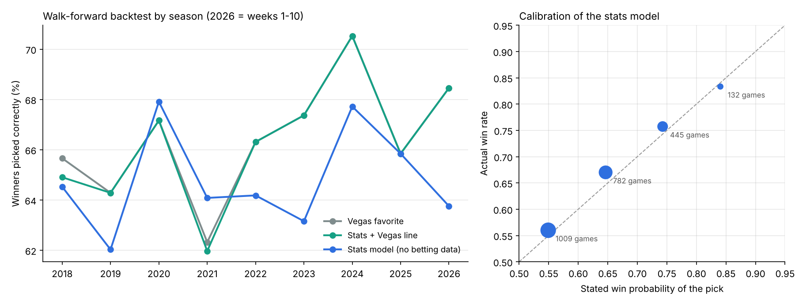

# nfl-predictor

[](https://github.com/aadijewargi/nfl-predictor/actions/workflows/ci.yml)


Predicts NFL game winners, point margins and win probabilities from public play-by-play
data. Each game is scored using only what was known before kickoff, and every number below
comes from a walk-forward backtest: each season is predicted by a model trained only on
the seasons before it.



## Results (2018 to 2026 week 10, 2,377 games with a posted line)

| Model | Winners correct | Log loss | Brier |
|---|---|---|---|
| **Stats model** (no betting data) | 64.9% | 0.629 | 0.219 |
| **Stats + Vegas line** | 66.2% | 0.611 | 0.211 |
| Vegas favorite (closing spread) | 66.3% | 0.611 | 0.212 |
| Always pick the home team | 54.0% | | |

Log loss scores the probabilities themselves (lower is better; a coin flip is 0.693).

What this shows:

* The **stats model** is independent of the betting market and well calibrated: picks
  it rates 70–80% won about 76% of the time. It trails the market by about 1.5 points
  of accuracy, which is typical for public-data models.
* Adding the **Vegas line** brings it level with the market, and the stats add almost
  nothing on top of the closing line. The closing spread already prices in what public
  stats know. Beating it consistently would need information the market lacks, such as
  injury news before it is public.
* When the stats model and Vegas disagree on the winner, Vegas has been right in 56%
  of the 303 such games. Treat a disagreement as a lean, not an edge.

## How it works

**Data.** [nflverse](https://github.com/nflverse) schedules, scores, listed starting QBs
and closing lines (`games.csv`), plus every play since 2016 with expected points added
(EPA).

**Features**, all as home-minus-away differences:

| Feature | Definition |
|---|---|
| Offensive and defensive EPA/play | Recency-weighted season-to-date averages (each older game counts 0.9×), dropping plays where either side's win probability is below 5%. Early in the season they lean on last season's rating regressed 45% to the mean, worth 4 games of evidence. |
| Elo | Margin-of-victory Elo (K = 20, home field = 48 points, 2/3 carried over between seasons). |
| Starting QB | The listed starter's EPA per dropback over his career, with a one-year half-life, shrunk toward −0.05 with 300 dropbacks of weight, so unknown backups start below average. |
| Rest, home field | Rest-day difference (capped at ±7) and a non-neutral-site flag. |

**Model.** A ridge regression predicts the home team's margin:

$$\hat m = \beta_0 + \sum_k \beta_k\,\Delta x_k, \qquad P(\text{home win}) = \Phi\!\left(\hat m / \sigma\right)$$

Here $\sigma \approx 13$ points is the spread of the training residuals. The Stats + Vegas
model uses the same regression on the spread, QB and Elo differences.

**What was tried and dropped** (see `experiments.py`): success rate, pass and rush EPA
splits, points scored and allowed, opponent-adjusted EPA, wind, and division games. None
improved log loss on the held-out 2024–2026 seasons. Settings were tuned on 2018–2023 only.

**No look-ahead.** `tests/test_model.py` hides every result after a given week and checks
that the features for that week do not change.

## Usage

```powershell
git clone https://github.com/aadijewargi/nfl-predictor.git
cd nfl-predictor
pip install -r requirements.txt

python -m nfl_model.data        # download data (~200 MB of play-by-play) and build team-game stats
python backtest.py              # walk-forward backtest of both models vs Vegas
python predict.py               # predict every remaining game this season
python make_figures.py          # redraw docs/backtest.png
python experiments.py           # compare feature variants

# each week, after Monday night's game:
python predict.py --refresh     # re-download this season and re-predict
pytest                          # tests (offline, synthetic data)
```

Outputs go to `output/`: `predictions_<season>.csv` (stats pick, win probability and
margin, plus the Stats + Vegas pick where a line is posted), `power_ratings_<season>.csv`,
and the backtest files.

## Limits

* No injuries beyond the listed starting QB, and no weather, travel or news.
* Games more than a week out use today's ratings and the most recent listed QB. Lines are
  usually posted only for the next week, so Stats + Vegas predictions exist only for those
  games.
* The backtest uses closing lines. Lines earlier in the week are slightly less accurate.

## Roadmap

* Player-level injury adjustments from nflverse injury reports
* Score totals (over/under) from pace and efficiency
* Season simulation: playoff odds from 10,000 Monte Carlo seasons

## License

MIT
